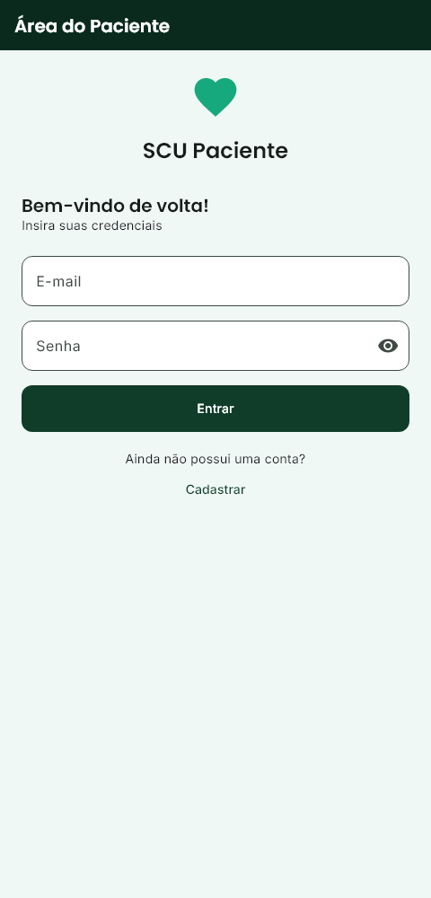
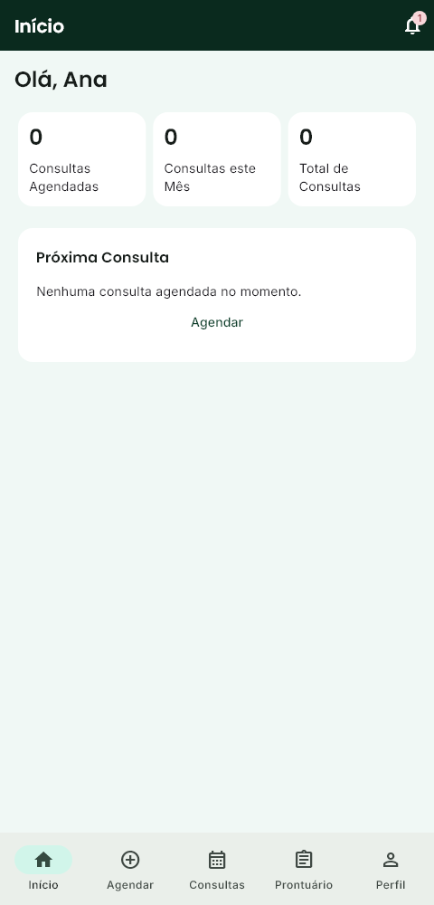

# Evidências — port Flutter do paciente

Data da conferência final: **2026-09-14**. Módulo: [SCU Paciente](../src/clinic-system/mobile/README.md). Escopo: [prompt de execução](../docs/mobile/prompt-porte-flutter-paciente.md).

O port implementa os 22 endpoints existentes em um aplicativo Android: autocadastro/login, início, agendamento em três passos, consultas/cancelamento, prontuário/prescrições, perfil, convênios e notificações. Backend e frontend não foram alterados. A estrutura para Google Play foi preparada sem conectar, enviar ou publicar o aplicativo.

## Validação local

Ambiente: Windows, Flutter 3.47.4, Dart 3.13.3, JDK 21 e Android SDK 36; aplicativo com minSdk 24. SDKs e caches foram instalados em diretórios temporários externos ao repositório.

| Verificação | Resultado |
| --- | --- |
| `flutter pub get` e `flutter pub outdated` | Dependências resolvidas e versões conferidas |
| `flutter test --no-pub --coverage` | **33 testes passaram** |
| `flutter analyze --no-pub` | Sem problemas encontrados |
| `dart format --set-exit-if-changed .` | 89 arquivos conferidos, nenhuma alteração |
| LCOV local | 1.564 de 1.856 linhas reportadas cobertas (84,3%); não representa cobertura de execução nativa |
| `git check-ignore -v src/clinic-system/mobile/lib/main.dart` | Sem saída; código Dart não é ignorado |
| Código de aplicação | Sem `print`, URL de servidor fixa ou log de payloads |

Os testes usam pacientes e respostas sintéticos com o cliente Dio real e transporte controlado. Foram exercitados os quatro formatos de erro, texto puro com Content-Type JSON, Bearer, expiração de sessão durante uso e reabertura, recusa de usuário não paciente, datas sem UTC, CPF, enums desconhecidos e recarga após escrita. A falha de GET posterior a uma criação concluída não oferece repetir o POST.

Nos testes de interface passaram login, os quatro estados de consultas, agendamento com seletores de data/hora, cadastro → login automático → agendar → listar → cancelar, edição de perfil, CRUD/principal de convênios, notificações e prontuário. Os testes de acessibilidade conferem alvos Android de 48 dp, rótulos e contraste em login/início, além de fonte ampliada. Isso não equivale à avaliação completa com TalkBack.

Logs locais ficam em `src/clinic-system/mobile/build/*-validation.log`, e cobertura em `coverage/lcov.info`; essas saídas são ignoradas pelo Git. O workflow de CI foi criado, mas não foi executado remotamente.

## Capturas de interface

Geradas por testes de widget com dados fictícios e fontes embarcadas, não por um emulador ou aparelho. A captura de tela da janela Android permanece bloqueada por `FLAG_SECURE`.

| Login | Início |
| --- | --- |
|  |  |

Para reproduzir as imagens localmente: `flutter test test/features/accessibility_test.dart --dart-define=SCU_CAPTURE_EVIDENCE=true`. As imagens são gravadas em `build/evidence/`.

## Rastreabilidade do roteiro

| Etapas da seção 13 | Evidência e limite |
| --- | --- |
| 1–4: projeto, Git, dependências e tema | Módulo Android compilável, análise limpa e capturas acima; abertura em emulador pendente |
| 5: rede | Testes de erros e contrato com Dio real |
| 6–9: sessão, login, cadastro e abas | Testes de sessão e interface; persistência real no Keystore após encerrar o processo pendente |
| 10–13: consultas, início e agendamento | Testes de estados, cálculos, payload e fluxo completo |
| 14–17: prontuário, perfil, convênios e notificações | Testes de contrato e interface; roteiro manual preparado |
| 18: acessibilidade | Verificações automatizadas parciais; percurso completo com TalkBack pendente |
| 19: testes | 33 testes locais aprovados; execução de `integration_test` em Android pendente |
| 20: CI | Workflow criado; execução em PR pendente |
| 21: release | Verificações de compilação descritas abaixo; instalação e uso no aparelho pendentes |

## Pendências autorizadas e externas

O usuário autorizou expressamente: **“Sim, avance e registre as validações pendentes”**, em resposta à indisponibilidade inicial de Android SDK/emulador. O SDK necessário à compilação foi instalado depois; emulador e aparelho não foram utilizados. Portanto, o aceite completo em dispositivo não está declarado concluído.

- Executar o [roteiro de aceite](../src/clinic-system/mobile/docs/aceite.md) em emulador e aparelho físico, incluindo TalkBack, rotação, rede, armazenamento seguro e bloqueio de capturas.
- Testar os fluxos contra backend real. A tentativa local em `localhost:8080` encontrou conexão recusada; os testes usaram API simulada.
- Definir URL HTTPS funcional e chave definitiva da equipe. Os artefatos de validação não constituem uma versão pronta para distribuição.
- Informar número de issue e sprint, vincular a branch, executar CI remoto e obter review do PR. Após a validação local, o usuário solicitou commit e envio em uma nova branch mobile: `feature/mobile-flutter-paciente`. O nome sem número de issue diverge do padrão de contribuição e deve ser regularizado antes do PR. PR, merge e publicação do aplicativo permanecem pendentes. O [rascunho do PR](../src/clinic-system/mobile/docs/pr-draft.md) registra essas dependências.
- Antes de qualquer envio futuro à loja, conferir identidade do app já criado e cumprir as pendências reais de conta, privacidade e exclusão descritas no [guia Google Play](../src/clinic-system/mobile/docs/google-play.md).

## Artefatos Android

Os três comandos finais de build terminaram com código zero, incluindo a verificação de símbolos nativos do AAB pelo Flutter. Arquivos locais em `src/clinic-system/mobile/build/app/outputs/` (não versionados):

| Artefato | Caminho relativo a outputs | Tamanho em bytes |
| --- | --- | --- |
| APK debug | `flutter-apk/app-debug.apk` | 218.602.894 |
| APK release | `flutter-apk/app-release.apk` | 60.772.291 |
| AAB release | `bundle/release/app-release.aab` | 58.720.084 |

SHA-256 para identificar exatamente os arquivos desta validação:

```text
app-debug.apk   203B56AA988A83B0E4CD3B94C1C3A2A14F45303FD3C1F1981222F513E9D42A8A
app-release.apk 8A4F004A42F9674BC5E882FB06F92B5F0D1FF49E4CAF7A60A40F6EC13D0C7597
app-release.aab C72452C0B233C9A54407DD2AFDBDE8127A86FAF3884DC7218FB994795849D10F
```

`apksigner verify --verbose` aprovou a assinatura v2 do APK. `jarsigner -verify` retornou `jar verified` e código zero para o AAB, com avisos sobre certificado de teste autoassinado, ausência de timestamp, atributos POSIX e leitura do manifesto/assinaturas por JarInputStream versus JarFile. Não foi feita validação ou aceitação pelo Play Console.

`aapt dump badging` confirmou pacote `br.edu.ceub.scu.paciente`, versão `1.0.0`/código `1`, Android mínimo 24, alvo 36 e ABIs arm64-v8a, armeabi-v7a e x86_64. O manifesto mesclado de release desabilita backup e não inclui liberação de HTTP nem a configuração de rede de debug.

O debug aponta para `http://10.0.2.2:8080`. **Os releases usam `https://scu.example.invalid` e uma chave temporária exclusiva de validação**, mantida fora do Git. Não servem para login real ou publicação. O `android/key.properties` usado no teste foi removido do workspace após os builds; a próxima compilação de release exige configurar a chave correta da equipe conforme o guia. Nenhuma chave existente do aplicativo no Console foi acessada ou substituída.
